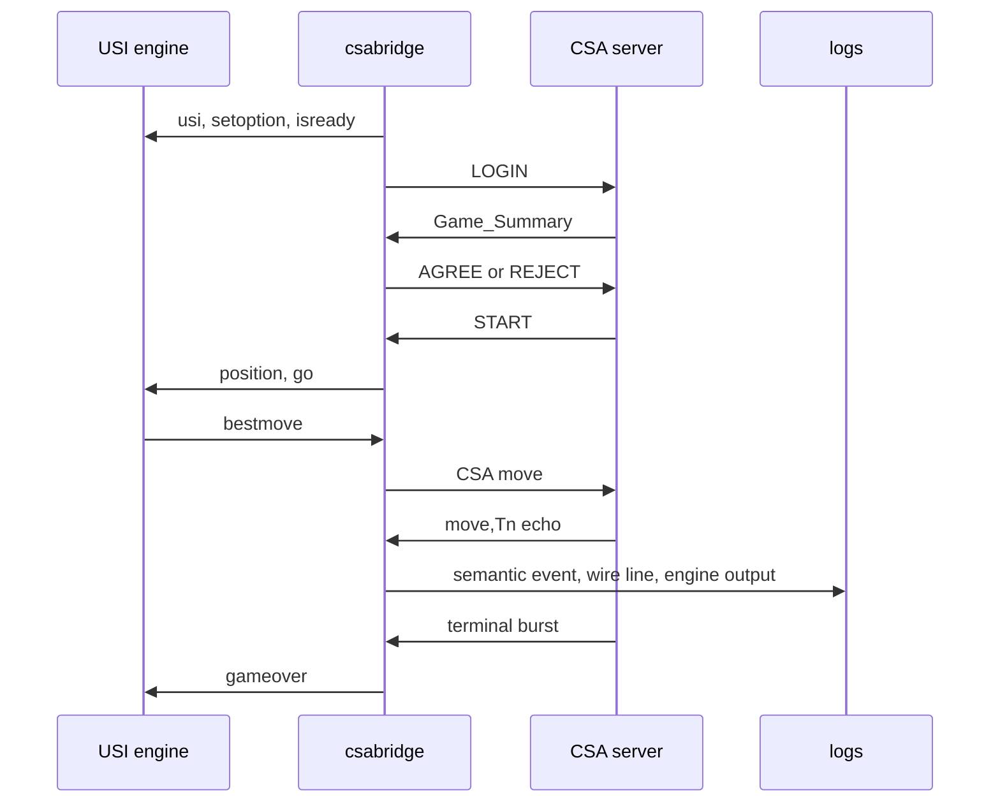

# セッションとデータの流れ

CSA は TCP 上で改行区切りの ASCII command を交換します。

space、LF、大文字小文字を含めて行の書式に意味があるため、bridge は codec と socket I/O を分けています。[^line-format]

この図で唯一サーバーが確定させるのは、着手の合法性、消費時間、終局です。

bridge はサーバーの結果を受け取ってから局面と時計を進めます。

## ログインから開始まで

TCP 接続後、client は `LOGIN <username> <password>` を送り、成功すると対局待ちになります。[^login]

server は `BEGIN Game_Summary` から `END Game_Summary` までに、protocol version、format、対局者、手番、時間設定、局面を示します。[^summary]

bridge はこの block を parse するだけで受理しません。

`Protocol_Version:1.2`、server mode、`Format:Shogi 1.0`、必須 field、局面、時間設定、`To_Move` を確認し、局面内に既に指し手があれば replay します。

読めない field や一致しない手番を既定値で補って `AGREE` すると、server と別の局面を持ったまま対局を始めることになります。

そのため bridge は対局可能な提案だけへ `AGREE <Game_ID>` を返し、それ以外は `REJECT <Game_ID>` を返します。

両者の `AGREE` を受けた server が `START:<Game_ID>` を送り、最初の手番の時計を開始します。[^agree]

## 着手エコーが局面と時計を確定する

自分の手番では、bridge が USI engine に局面と残り時間を渡して `go` を送ります。

engine の `bestmove` を CSA 表記へ変換し、局面上で合法性を確認してから server へ送ります。

server は着手を判定し、たとえば `+7776FU,T12` のように消費時間を付けて両者へ返します。[^move-echo]

bridge はこの echo を受けた時点でだけ局面と `ClockLedger` を更新します。

送信直後に局面を進めると、server が不正手や時間切れを裁定した場合に、bridge の局面だけが先走るからです。

相手の指し手も同じ echo として届くため、双方の残り時間は server が付けた `,T` を台帳へ反映して再構成できます。

## 終局と待機への復帰

投了、時間切れ、千日手、反則、入玉宣言、手数上限では、server は終局理由と勝敗を示す terminal line を送ります。[^terminal]

bridge は terminal burst を `gameover` へ翻訳して engine に伝え、`game_end` record を書きます。

通常 mode ではその対局の接続を閉じます。

指定した対局数に達していなければ、新しい接続で次の対局を待ちます。

正常に終えるときは、接続を自分で保持している待機状態で `LOGOUT` を送り、最後に `bridge_stop` を書きます。

[^line-format]: [CSA サーバプロトコル ver.1.2.1: 通信モデル](https://www.computer-shogi.org/protocol/tcp_ip_server_121.html)

[^login]: [CSA サーバプロトコル ver.1.2.1: ログインとログアウト](https://www.computer-shogi.org/protocol/tcp_ip_server_121.html)

[^summary]: [CSA サーバプロトコル ver.1.2.1: 対局条件と局面情報](https://www.computer-shogi.org/protocol/tcp_ip_server_121.html)

[^agree]: [CSA サーバプロトコル ver.1.2.1: 対局の合意](https://www.computer-shogi.org/protocol/tcp_ip_server_121.html)

[^move-echo]: [CSA サーバプロトコル ver.1.2.1: 指し手と意思表示](https://www.computer-shogi.org/protocol/tcp_ip_server_121.html)

[^terminal]: [CSA サーバプロトコル ver.1.2.1: 終局通知](https://www.computer-shogi.org/protocol/tcp_ip_server_121.html)
